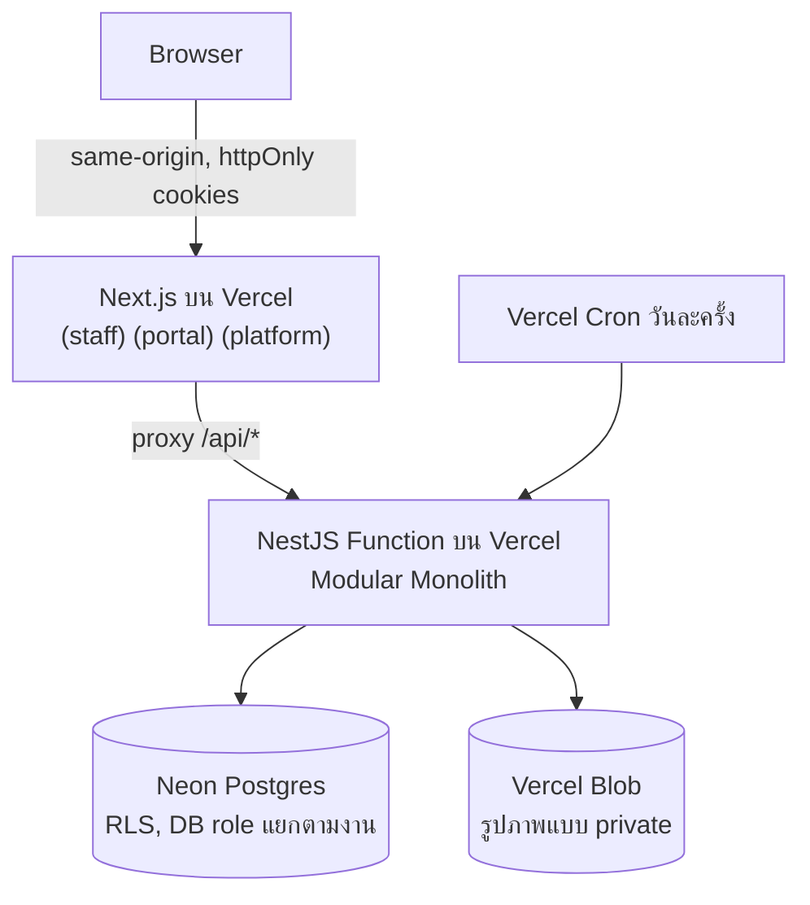
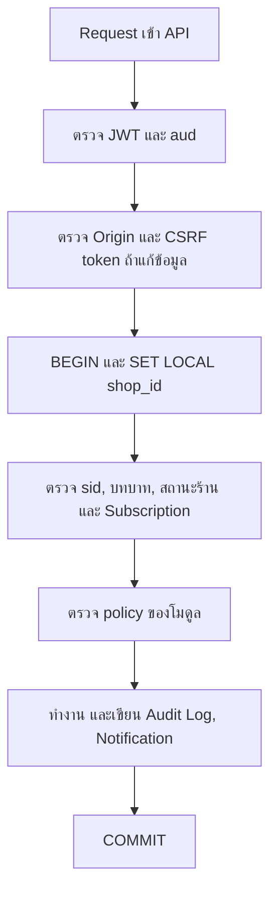
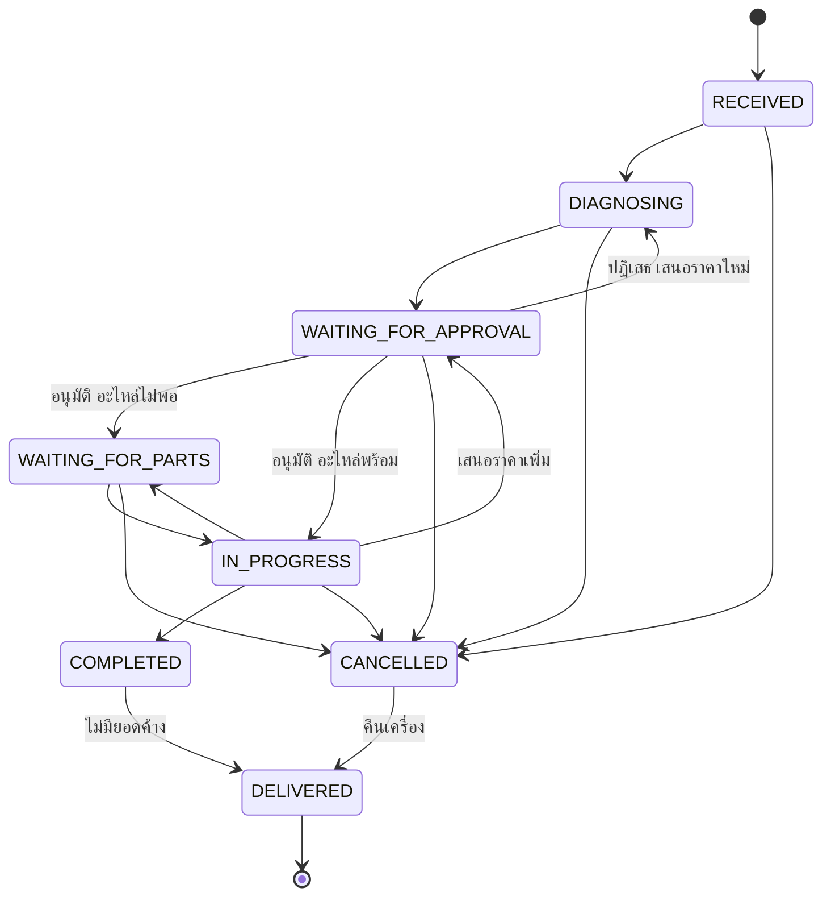
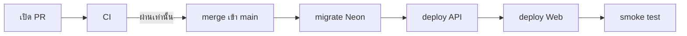

# RepairFlow Architecture

เอกสารนี้อธิบายโครงสร้างระบบและกฎที่โค้ดต้องยึด ขอบเขตผลิตภัณฑ์เริ่มต้นอยู่ใน [RepairFlow-Portfolio-Project.md](RepairFlow-Portfolio-Project.md) ถ้าข้อความขัดกัน เอกสารนี้ใช้แทน

คำศัพท์ทางธุรกิจอยู่ใน [GLOSSARY.md](../GLOSSARY.md) เหตุผลของการตัดสินใจหลักอยู่ใน [ADR](adr/) และข้อมูลอ้างอิงภายนอกอยู่ใน [ผลการค้นคว้า](research/inventory-and-free-hosting.md)

## ภาพรวม



| ส่วน | เทคโนโลยี |
|---|---|
| Frontend | Next.js, TypeScript, shadcn/ui, Tailwind CSS, React Hook Form |
| Contract | Zod ใน `packages/contracts` และสร้าง OpenAPI จาก schema |
| Backend | NestJS, TypeScript, Drizzle ORM |
| Database | PostgreSQL บน Neon Free |
| Testing | Vitest, Playwright |
| Delivery | GitHub Actions, Vercel Hobby, Docker Compose สำหรับพัฒนาในเครื่อง |

### โครงสร้าง repo

```text
apps/api            NestJS
apps/web            Next.js
packages/contracts  Zod schema และ type ที่ใช้ร่วมกัน
docs/               architecture, roadmap, Sprint Log, ADR, research
```

## ข้อจำกัดของโปรเจกต์

- **งานแสดงผลงานที่ต้องฟรี:** ไม่ผูกบัตร ไม่ซื้อโดเมน ([ADR-0008](adr/0008-free-deployment-on-vercel-and-neon.md))
- **ไม่รับเงินจริง:** ทั้ง Payment และ Subscription ([ADR-0007](adr/0007-simulated-subscription-payments.md))
- **ไม่แจ้งเตือนออกนอกแอป** ([ADR-0006](adr/0006-in-app-notifications-only.md))
- **กำหนด 12 สัปดาห์** ดู[แผนและลำดับการตัดงาน](#แผนและลำดับการตัดงาน)

## โมดูล

Backend เป็น Modular Monolith โมดูลเรียกกันแบบ synchronous ผ่าน service ที่ export และใช้ transaction เดียวกันผ่าน AsyncLocalStorage ([ADR-0002](adr/0002-synchronous-module-calls-with-shared-transaction.md))

| โมดูล | รับผิดชอบ | เรียกใช้ได้ |
|---|---|---|
| `audit-logs` | เขียนและค้น Audit Log | - |
| `notifications` | Notification และ Customer Contact Task | - |
| `shops` | ข้อมูลร้าน, การสมัคร, สถานะการระงับ | `audit-logs` |
| `users` | User, บทบาท, ลิงก์เชิญ, recovery codes | `shops`, `audit-logs` |
| `auth` | ล็อกอิน, token, การตรวจ request | `users`, `shops`, `audit-logs` |
| `customers` | Customer และ Device | `audit-logs` |
| `inventory` | Part, ยอดตามสถานะ, Reservation, Issue, Part Request, Stock Movement | `notifications`, `audit-logs` |
| `work-orders` | Work Order, การเปลี่ยนสถานะ, Status History, รูปภาพ | `customers`, `inventory`, `notifications`, `audit-logs` |
| `quotations` | Quotation และ Approval | `work-orders`, `inventory`, `notifications`, `audit-logs` |
| `payments` | Payment และ Outstanding Balance | `quotations`, `audit-logs` |
| `billing` | Subscription, Trial, `PaymentProvider` | `shops`, `audit-logs` |
| `reports` | Dashboard แบบอ่านอย่างเดียว | อ่านตารางของร้านได้โดยตรง |
| `platform` | งานของ Platform Admin | `shops`, `billing`, `audit-logs` |

ตารางนี้เป็นจุดเริ่มต้นและปรับได้ตอนลงมือ แต่ต้องคงกฎเหล่านี้:

- โมดูลห้าม query ตารางของโมดูลอื่น ยกเว้น `reports`
- กราฟการเรียกต้องไม่มีวงจร และ CI บังคับด้วย dependency-cruiser
- โมดูล import โมดูลอื่นได้จากไฟล์ที่อยู่ระดับบนสุดของโมดูลนั้นเท่านั้น ห้าม import จากโฟลเดอร์ย่อย เพราะ dependency-cruiser จะมองไม่เห็นวงจรที่ผ่านเส้นทางแบบนั้น
- `work-orders` ต้องรู้ Outstanding Balance ก่อนเปลี่ยนเป็น Delivered แต่ `payments` อยู่สูงกว่าในกราฟ จึงให้ `work-orders` ประกาศ port และให้ `payments` เป็นผู้ implement

## Tenancy และการเข้าถึงฐานข้อมูล

ทุกตารางข้อมูลร้านมี `shop_id` และบังคับด้วย RLS ([ADR-0001](adr/0001-shared-schema-multi-tenancy-with-rls.md))

| DB role | ใช้โดย | สิทธิ์ |
|---|---|---|
| Migration (จาก Neon Console) | CI ตอน migrate เท่านั้น | เจ้าของ schema, มี `BYPASSRLS` |
| `app_tenant` (สร้างด้วย SQL) | API ของร้าน | ถูกจำกัดด้วย RLS และ `FORCE` |
| `app_platform` (สร้างด้วย SQL) | โมดูล `platform` | เฉพาะตาราง platform และ view ตัวเลขรวม |
| `app_system` (สร้างด้วย SQL) | Cron | เฉพาะการรีเซ็ต Demo Shop และลบร้านที่ไม่ใช้งาน |

กฎที่ต้องมีเทสต์:

- role ของแอปต้องมี `rolsuper = false` และ `rolbypassrls = false`
- ใช้ composite foreign key `(shop_id, id)` กันการอ้างอิงข้ามร้าน
- query ที่ไม่ได้ตั้ง `shop_id` ต้องไม่คืนข้อมูลของร้านใด
- เชื่อมต่อด้วย `pg` Pool และ `attachDatabasePool` เพราะ HTTP driver ของ Neon ไม่รองรับ interactive transaction

### ลำดับการทำงานของ request



## Authentication และ Authorization

รายละเอียดและเหตุผลอยู่ใน [ADR-0003](adr/0003-per-shop-user-accounts.md) และ [ADR-0004](adr/0004-jwt-in-httponly-cookies-checked-against-db.md)

- **การล็อกอิน:** พนักงานและ Customer ใช้ `/s/:shopSlug/login` ส่วน Platform Admin แยกหน้า
- **Token:** access JWT อายุ 10 นาที และ refresh token ที่หมุนทุกครั้ง เก็บ hash ใน DB และเพิกถอนทั้งชุดเมื่อพบการใช้ซ้ำ
- **Cookie:** httpOnly, Secure, `SameSite=Strict` โดย refresh token จำกัด path ที่ endpoint สำหรับ refresh
- **การป้องกันอื่น:** ตรวจ `Origin`, CSRF token, CSP แบบเข้มงวด, `scrypt` สำหรับรหัสผ่าน และจำกัดการล็อกอินผิดด้วยข้อมูลใน Postgres
- **การเพิกถอน:** การตรวจกับ DB ทุก request ทำให้การระงับร้านและการเปลี่ยนบทบาทมีผลทันที
- **ลิงก์เชิญและ reset:** ใช้ครั้งเดียว มีวันหมดอายุ และเก็บเฉพาะ hash Receptionist ออกให้ Customer ได้ และ Owner ออกให้พนักงานได้
- **การกู้บัญชี Owner:** ใช้ recovery codes ถ้าหายให้กู้ผ่าน CLI พร้อมบันทึก Audit Log

Authorization อยู่ใน backend เป็น policy function ของแต่ละโมดูล และเทสต์แบบ matrix ทั้งบทบาทและเจ้าของข้อมูล

| การกระทำ | Owner | Receptionist | Technician | Customer |
|---|---|---|---|---|
| ดู Work Order | ทั้งร้าน | ทั้งร้าน | ทั้งร้าน | ของตนเท่านั้น |
| สร้าง Work Order และ Customer (เริ่มที่ RECEIVED) | ได้ | ได้ | ไม่ได้ | ไม่ได้ |
| เปลี่ยนสถานะงานซ่อม: RECEIVED → DIAGNOSING, WAITING_FOR_PARTS ↔ IN_PROGRESS, IN_PROGRESS → COMPLETED | ได้ | ไม่ได้ | เฉพาะงานที่รับมอบหมาย | ไม่ได้ |
| Issue Part | ได้ | ไม่ได้ | เฉพาะงานที่รับมอบหมาย | ไม่ได้ |
| บันทึกผลการซ่อม, `MARK_DEFECTIVE` ของ Part ในงาน, `RETURN_UNUSED` | ได้ | ไม่ได้ | เฉพาะงานที่รับมอบหมาย | ไม่ได้ |
| ออก Quotation: การส่งเปลี่ยน DIAGNOSING หรือ IN_PROGRESS → WAITING_FOR_APPROVAL | ได้ | ได้ | ไม่ได้ | ไม่ได้ |
| ตอบ Quotation | บันทึกแทน | บันทึกแทน | ไม่ได้ | ของตนเท่านั้น |
| มอบหมาย Technician, ยกเลิก Work Order | ได้ | ได้ | ไม่ได้ | ไม่ได้ |
| เปลี่ยนเป็น DELIVERED: จาก COMPLETED หรือ CANCELLED | ได้ | ได้ | ไม่ได้ | ไม่ได้ |
| บันทึก Payment | ได้ | ได้ | ไม่ได้ | ไม่ได้ |
| ดูยอด Part | ได้ | ได้ | ได้ | ไม่ได้ |
| รายการ Part, `RECEIPT` | ได้ | ไม่ได้ | ไม่ได้ | ไม่ได้ |
| `MARK_DEFECTIVE` ของ Part ที่ไม่ผูกกับ Work Order เช่น Store Damage | ได้ | ไม่ได้ | ไม่ได้ | ไม่ได้ |
| `INSPECT_PASS`, `INSPECT_FAIL`, `VENDOR_SEND`, `VENDOR_RESOLVE` | ได้ | ไม่ได้ | ไม่ได้ | ไม่ได้ |
| ปรับยอดจากการนับ, Scrap, จัดลำดับคิว | ได้ | ไม่ได้ | ไม่ได้ | ไม่ได้ |
| รายงาน, จัดการ User ของพนักงาน | ได้ | ไม่ได้ | ไม่ได้ | ไม่ได้ |

เจ้าของโปรเจกต์ทบทวนและยืนยันตารางนี้เมื่อ 1 พ.ย. 2569

- **การตีความที่เจ้าของโปรเจกต์ยังไม่ได้ทบทวนแยก:** สองข้อนี้ตีความจากการตัดสินใจเรื่องงานหน้าร้าน คือ "การรับเครื่อง" ของ Receptionist หมายถึงการเริ่ม Work Order ที่ RECEIVED เท่านั้น ไม่รวม RECEIVED → DIAGNOSING และ Quotation เพิ่มเติมที่เปลี่ยน IN_PROGRESS → WAITING_FOR_APPROVAL นับเป็นการส่ง Quotation

- **จัดการ User ของพนักงาน:** ไม่รวมลิงก์เชิญและ reset ของ Customer ซึ่ง Receptionist ออกให้ได้ตามหัวข้อลิงก์เชิญและ reset ด้านบน
- **Technician:** เห็น Work Order ทั้งร้าน แต่เขียนได้เฉพาะงานที่รับมอบหมาย
- **ผลของการตอบ Quotation:** การเปลี่ยนจาก WAITING_FOR_APPROVAL เป็น IN_PROGRESS, WAITING_FOR_PARTS หรือ DIAGNOSING เกิดใน [transaction ที่บันทึกคำตอบ](#quotation-และ-approval) ตามแถวตอบ Quotation จึงไม่ใช่สิทธิ์เปลี่ยนสถานะโดยตรง

## Workflow ของ Work Order

การเปลี่ยนสถานะเป็น transition table แบบ pure function พร้อม guard จึงเทสต์ได้โดยไม่ใช้ DB



- การยกเลิกต้องระบุเหตุผล และคืน Reservation ที่ยังไม่ถูกเบิกกลับเป็น Available
- ทุกการเปลี่ยนสถานะเขียน Status History และ Audit Log ใน transaction เดียวกัน

## Quotation และ Approval

- ส่งแล้วแก้ไม่ได้ ถ้าเปลี่ยนต้องออกฉบับใหม่ซึ่งแทนฉบับเดิม
- เก็บราคาแต่ละรายการเป็น snapshot ตอนออกใบ
- กันการอนุมัติซ้ำและการอนุมัติใบที่หมดอายุด้วย `UPDATE ... WHERE status = 'SENT' AND expires_at > now()` ถ้าไม่มีแถวถูกแก้แปลว่าไม่สำเร็จ
- การหมดอายุตรวจจากวันที่ จึงไม่ต้องมี scheduler
- พนักงานบันทึกแทนได้ โดยระบุช่องทางและผู้บันทึก

การอนุมัติเป็น transaction เดียว:

1. เปลี่ยนสถานะ Quotation
2. จอง Part ทุกรายการ ส่วนที่ขาดสร้าง Part Request
3. เปลี่ยนสถานะ Work Order เป็น `IN_PROGRESS` หรือ `WAITING_FOR_PARTS`
4. เขียน Audit Log และ Notification

การปฏิเสธเปลี่ยน Work Order จาก WAITING_FOR_APPROVAL เป็น DIAGNOSING ใน transaction เดียวกับที่บันทึกการปฏิเสธ ส่วนการปฏิเสธ Quotation เพิ่มเติมยังเป็นคำถามเปิด Q5 ใน [PRD](prd.md#คำถามที่-acceptance-criteria-ยังตอบไม่ได้)

## Inventory

เหตุผลอยู่ใน [ADR-0005](adr/0005-stock-buckets-reservation-and-conditional-update.md)

ยอดเก็บแยกตามสถานะ แต่ละสถานะมี `CHECK >= 0` และทุกการเปลี่ยนยอดเขียน Stock Movement ที่แก้ไขไม่ได้

| Movement | จาก → ไป | ผู้ทำ / เงื่อนไข |
|---|---|---|
| `RECEIPT` | ภายนอก → Available หรือ Quarantine | จัดสรรให้ Part Request ตามคิวใน transaction เดียวกัน |
| `RESERVE` | Available → Reserved | ตอนเกิด Approval |
| `RELEASE` | Reserved → Available | ตอนยกเลิกงาน |
| `ISSUE` | Reserved → งาน | บันทึกต้นทุนต่อหน่วย |
| `RETURN_UNUSED` | งาน → Available | คืนของที่ไม่ได้ใช้ |
| `MARK_DEFECTIVE` | Available หรืองาน → Quarantine | ต้องระบุ `STORE_DAMAGE`, `REPAIR_DAMAGE` หรือ `DOA` |
| `INSPECT_PASS` | Quarantine → Available | |
| `INSPECT_FAIL` | Quarantine → Defective | |
| `VENDOR_SEND` | Defective → At Vendor | คืนหรือส่งซ่อม |
| `VENDOR_RESOLVE` | At Vendor → Available หรือภายนอก | ได้ของแทน ซ่อมกลับมา หรือได้ credit |
| `SCRAP` | Quarantine หรือ Defective → ภายนอก | Owner เท่านั้น ต้องระบุเหตุผล |
| `COUNT_ADJUST` | ภายนอก ↔ Available | Owner เท่านั้น ต้องระบุเหตุผล |

### การแย่งอะไหล่

ตัวอย่างการจอง:

```sql
UPDATE stock_levels
SET available = available - :qty, reserved = reserved + :qty
WHERE shop_id = :shopId AND part_id = :partId AND available >= :qty;
```

- ถ้าไม่มีแถวถูกแก้ แปลว่าของไม่พอ และให้ส่วนที่ขาดเข้าคิว Part Request
- Issue ตัดจากยอดจองของ Work Order นั้นเท่านั้น งานอื่นจึงแย่งไม่ได้
- คิวจัดสรรตามลำดับก่อนหลัง และ Owner ปรับลำดับได้

### อะไหล่เสีย

- **Repair Damage:** ร้านรับต้นทุน ไม่คิดเงิน Customer และไม่ต้องขอ Approval ใหม่ ต้นทุนแยกแสดงในรายงาน
- **DOA:** ไม่คิดเงิน Customer และเคลมกับผู้ขาย
- **ชิ้นทดแทน:** ใช้ `RESERVE` และ `ISSUE` ตามปกติ ถ้าของไม่พอจะเข้าคิว
- **ลูกค้าจ่ายเพิ่ม:** ต้องผ่าน Quotation ใหม่เท่านั้น

### สิ่งที่ไม่ทำใน MVP

Serial และ lot, หลายคลัง, RMA เต็มรูปแบบ, ใบสั่งซื้อเต็มรูปแบบ, การคำนวณต้นทุนเฉลี่ย และงาน refurbish

## การรับมือความล้มเหลว

ทุกกรณีต้องเป็น integration test กับ Postgres จริง

| กรณี | พฤติกรรมที่ต้องได้ |
|---|---|
| Error กลาง transaction | Rollback ทั้งยอดสต็อก, Stock Movement และ Audit Log |
| Process ตายก่อน commit | ข้อมูลไม่เปลี่ยน |
| Commit แล้ว แต่ client ส่งคำขอซ้ำ | `Idempotency-Key` คืนผลเดิมโดยไม่ทำงานซ้ำ |
| เบิกหลายรายการแล้วเกิด deadlock | ล็อกตามลำดับ ID ที่เรียงแล้ว และ retry เมื่อเจอ `40P01` |
| คำขอพร้อมกันต่อ Part ชิ้นสุดท้าย | สำเร็จคำขอเดียว |

- ใช้ `Idempotency-Key` กับ Issue, Approval และการบันทึก Payment โดยเก็บ key ใน transaction เดียวกับงานนั้น
- การ Issue หลายรายการสำเร็จหรือล้มเหลวพร้อมกันทั้งใบ
- มีการตรวจว่ายอดคงเหลือตรงกับผลรวมของ Stock Movement

## การเงิน

**Payment** บันทึกอย่างเดียวและไม่เชื่อม gateway เก็บยอด วิธีชำระ และผู้รับเงิน รองรับการจ่ายบางส่วน และห้าม Delivered ถ้ายังมี Outstanding Balance

**Subscription** มีแผนเดียวพร้อม Trial ผ่าน `PaymentProvider` ([ADR-0007](adr/0007-simulated-subscription-payments.md))

| สถานะร้าน | พนักงาน | Customer |
|---|---|---|
| Trial หรือ Subscription ใช้งานอยู่ | ใช้งานได้ปกติ | ใช้งานได้ปกติ |
| Expired Shop | อ่านอย่างเดียว | ติดตามงานและตอบ Quotation ที่ค้างได้ |
| Suspended Shop | ใช้ไม่ได้ | ใช้ไม่ได้ |

บังคับด้วย global guard ใน NestJS และการหมดอายุตรวจจากวันที่

## Notification

เขียนใน transaction เดียวกับเหตุการณ์ และดึงตอนเปิดหน้าหรือกลับมาที่แท็บ ส่วน Customer ที่ไม่มีบัญชีจะเกิด Customer Contact Task ให้พนักงานติดต่อแล้วบันทึกช่องทางกับผู้ติดต่อ ([ADR-0006](adr/0006-in-app-notifications-only.md))

## รายงาน

| ตัวเลข | นิยาม |
|---|---|
| งานตามสถานะ | นับจากสถานะปัจจุบันของ Work Order |
| งานเกินกำหนด | เลย Promised Date แล้วยังไม่ COMPLETED และไม่ CANCELLED |
| ระยะเวลาซ่อมเฉลี่ย | RECEIVED ถึง COMPLETED จาก Status History ไม่รวมงาน CANCELLED |
| รายได้ | ยอด Payment ที่รับจริงตามวันที่รับ |
| งานของช่าง | Work Order ที่ยังไม่ปิดตาม Technician ที่รับมอบหมาย |
| ต้นทุนความเสียหาย | ต้นทุนจาก Stock Movement ที่เป็น Repair Damage |

- Query สดจากตารางจริง ไม่ทำ rollup ถ้าช้าค่อยเพิ่ม index หรือ materialized view เมื่อมีผลวัด
- ทุกตัวเลขหลักกดดูรายการต้นทางได้
- เงินเก็บเป็นจำนวนเต็มหน่วยสตางค์ เวลาเก็บ UTC และรวมยอดตาม timezone ของ Shop

## รูปภาพ

เก็บใน Vercel Blob แบบ private เข้าถึงผ่าน API ที่ตรวจสิทธิ์ บีบอัดฝั่งเว็บ และไม่เกิน 5 รูปต่อ Work Order Workflow ต้องทำงานต่อได้แม้โหลดรูปไม่ได้ เพราะถ้าเกิน quota ของ Hobby จะใช้ Blob ไม่ได้ 30 วัน

## Platform Admin

ดูรายชื่อร้านและสถานะ Subscription ดูตัวเลขการใช้งานรวม ระงับหรือเปิดร้าน และดู Audit Log ของฝั่ง platform แต่อ่านข้อมูลงานของร้านไม่ได้และไม่มี impersonation ([ADR-0009](adr/0009-platform-admin-cannot-read-shop-data.md))

## Delivery

- **ในเครื่อง:** Docker Compose สำหรับ Postgres
- **CI ของ PR:** lint, unit, integration กับ Postgres ใน container, E2E ด้วย Playwright, dependency-cruiser และ build image ของ API โดยไม่ใช้ secret และไม่ปลุก Neon
- **Deploy:** merge เข้า `main` แล้วขึ้น production อัตโนมัติบน Vercel สองโปรเจกต์ (web และ api) ไม่ผูกบัตร และไม่ทำ keep-alive



กฎของ pipeline:

- **การสั่ง deploy:** GitHub Actions เป็นผู้สั่ง และปิด auto-deploy ของ Vercel เพื่อให้ migration เสร็จก่อนโค้ดใหม่ขึ้น โดย deploy ทีละรอบตามลำดับที่ merge
- **การเชื่อม Web กับ API:** ใช้ rewrite ใน `apps/web/next.config.ts` ส่ง `/api/*` ไปยังโดเมน production ของ API ผ่าน environment variable เพื่อให้ browser เห็นโดเมนเดียวและ cookie แบบ `SameSite=Strict` ทำงานได้
- **การป้องกัน `main`:** branch protection ให้ merge ได้เมื่อ CI ผ่านเท่านั้น
- **Migration:** ต้องเข้ากันได้กับโค้ดเวอร์ชันก่อนหน้า การลบหรือเปลี่ยนชื่อคอลัมน์จึงแยกเป็น 2 PR คือเพิ่มของใหม่ก่อน แล้วค่อยลบของเก่า ไม่มี down migration อัตโนมัติ ถ้าข้อมูลพลาดให้เขียน migration ใหม่เพื่อแก้ไปข้างหน้า
- **Secret:** ของ production อยู่ใน GitHub Environment `production` และใช้เฉพาะ job ที่รันจาก `main` ไม่ใช้ `pull_request_target` และตรึงเวอร์ชันของ Actions ด้วย commit SHA
- **Preview:** ไม่มี Preview Deployment ใน MVP เพราะไม่ควรชี้ไปฐานข้อมูล production และการแยกฐานข้อมูลต่อ PR กิน quota ของ Neon
- **เมื่อ deploy พัง:** smoke test เรียก health endpoint ของ API และเปิดหน้าล็อกอินบน URL จริง ถ้าไม่ผ่าน workflow จะล้มเหลวและ GitHub แจ้งเตือน จากนั้นย้อนโค้ดด้วย rollback ของ Vercel ตามขั้นตอนใน README ไม่ย้อนอัตโนมัติ

งานอื่น:

- **Cron วันละครั้ง:** รีเซ็ต Demo Shop จาก seed script และลบร้านทดลองที่ไม่ใช้งานครบ 7 วัน
- **การสมัคร:** จำกัดต่อ IP และเพดานต่อวัน โดยเก็บตัวนับใน Postgres
- **เดโม:** Demo Shop มีบัญชีครบทุกบทบาท และบัญชี Platform Admin ของเดโมอ่านอย่างเดียว

## แผนและลำดับการตัดงาน

คงกำหนด 12 สัปดาห์ แต่ใช้แผน 6 Sprint ใน [roadmap.md](roadmap.md) แทนแผนในเอกสารตั้งต้น โดยยึดลำดับดังนี้:

1. สัปดาห์แรก ทดลอง deploy ตาม[รายการด้านล่าง](#ความเสี่ยงและสิ่งที่ต้องทดลอง)
2. Tenancy, RLS และ Audit Log ทำตั้งแต่ schema แรก เพราะเติมทีหลังยาก
3. Workflow หลักจบก่อน แล้วจึงทำ billing และ platform admin

ถ้าไม่ทันให้ตัดตามลำดับ:

1. ลด platform admin เหลือดูและระงับร้าน
2. ตัดการจ่ายบางส่วน
3. ตัดสถานะ At Vendor

ข้อยกเว้นคือ ถ้า Work Order ยังเดินจาก RECEIVED ถึง DELIVERED ไม่ได้เมื่อจบสัปดาห์ที่ 8 ให้ตัด billing ก่อนรายการข้างต้น

## ความเสี่ยงและสิ่งที่ต้องทดลอง

เจ้าของโปรเจกต์เคย deploy NestJS บน Vercel โดยเชื่อมกับ Next.js ผ่าน rewrite ใน `next.config.ts` สำเร็จแล้ว แต่ยังไม่มีการ deploy repo นี้หรือสร้าง role จริงบน provider ใด สิ่งที่ต้องยืนยันในสัปดาห์แรก:

- [ ] NestJS, Next.js และ `packages/contracts` ใน monorepo เดียวบน Vercel สองโปรเจกต์
- [ ] `SET LOCAL` ผ่าน pooler ของ Neon
- [ ] Cookie ผ่าน proxy `/api/*`
- [ ] Cold start ของ NestJS บน Vercel
- [ ] การอัปโหลดและอ่าน Blob แบบ private ผ่าน API
- [ ] การ deploy จาก GitHub Actions ไป Vercel สองโปรเจกต์ โดยปิด auto-deploy ของ Vercel

ถ้า backend บน Vercel ไม่ผ่าน แผนสำรองคือ Render Free ซึ่งมี cold start ราว 1 นาที

## ข้อจำกัดที่ต้องระบุใน Portfolio

- ไม่มี MFA และไม่มี OTP เบอร์โทรจึงไม่ได้ยืนยันตัวตนจริง
- ระบบไม่แจ้งเตือนออกนอกแอป และถ้า Customer ไม่ล็อกอิน พนักงานต้องติดต่อเอง
- การชำระ Subscription เป็นการจำลอง และ Payment เป็นการบันทึกอย่างเดียว
- Quota ของ Vercel และ Neon อาจหมดจนเดโมหยุดชั่วคราว
- Vercel Hobby จำกัดเฉพาะการใช้งานที่ไม่ใช่เชิงพาณิชย์ ถ้าทำเป็นของจริงต้องย้ายหรืออัปเกรด
