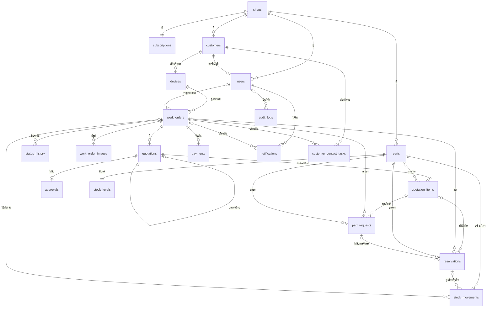
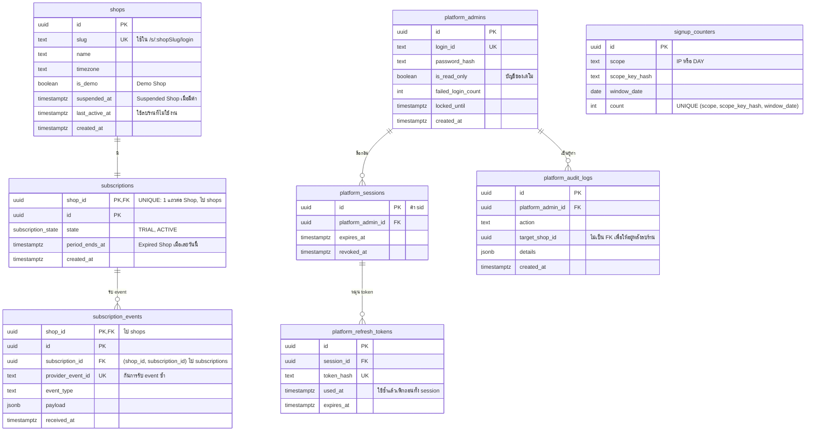
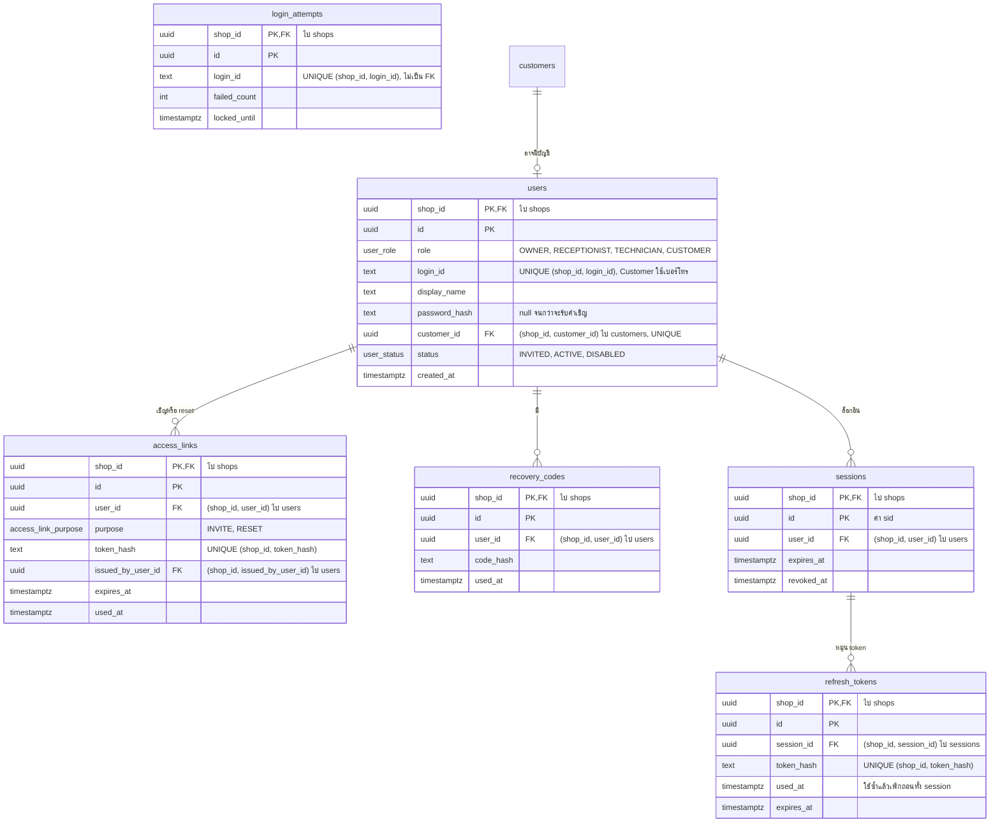
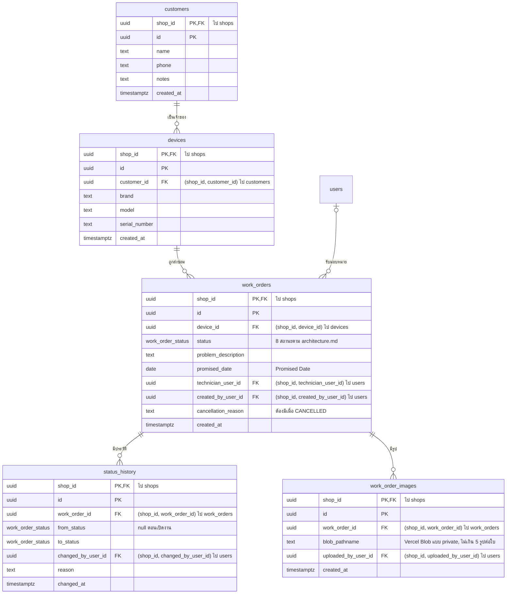
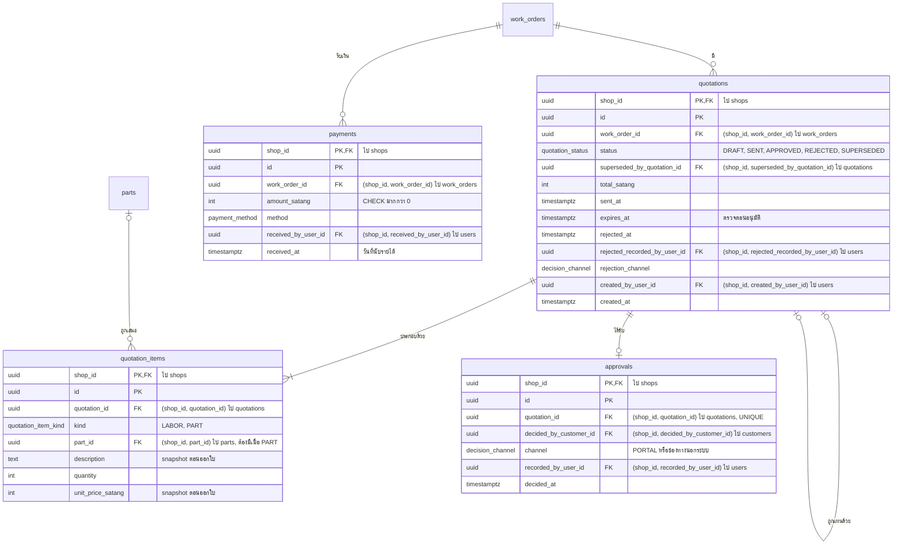
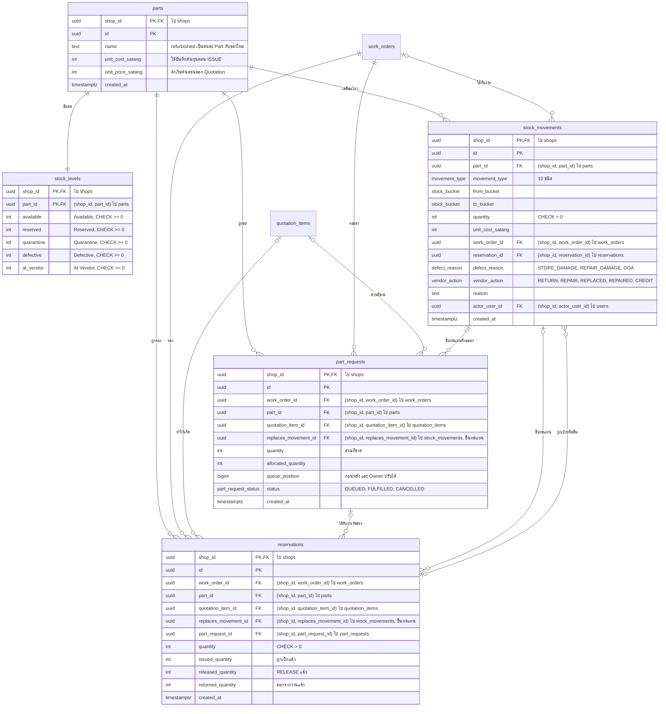
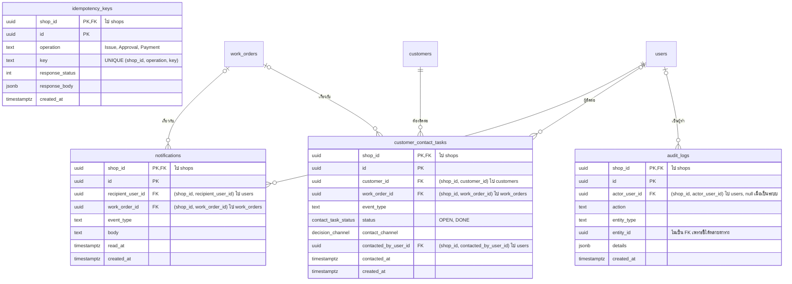

# RepairFlow ERD

เอกสารนี้แสดงโครงสร้างข้อมูลทั้งระบบเพื่อใช้สร้าง schema ตั้งแต่ Sprint 2 กฎและเหตุผลอยู่ใน [architecture.md](architecture.md) และ [ADR](adr/) ส่วนความหมายของคำอยู่ใน [GLOSSARY.md](../GLOSSARY.md) ถ้าข้อความขัดกัน เอกสารเหล่านั้นใช้แทน

คอลัมน์ที่เอกสารต้นทางระบุไว้ต้องคงตามนี้ ส่วนคอลัมน์อื่นเป็นข้อเสนอที่ปรับได้ตอนเขียน migration จุดที่เอกสารต้นทางยังไม่ตรงกันอยู่ใน[เรื่องที่ต้องตัดสินใจ](#เรื่องที่ต้องตัดสินใจ)

## กฎที่ใช้กับทุกตาราง

### ตารางข้อมูลของ Shop

ทุกตารางข้อมูลของ Shop ใช้กฎเดียวกัน ([ADR-0001](adr/0001-shared-schema-multi-tenancy-with-rls.md)):

- มี `shop_id` และ primary key เป็น `(shop_id, id)` ตารางลูกจึงอ้างแม่ด้วย composite foreign key ได้ทุกตาราง
- ทุกการอ้างถึงตารางของ Shop เป็น composite foreign key `(shop_id, <คอลัมน์>)` เพราะการตรวจ foreign key ไม่ผ่าน RLS มีเพียง `shop_id` เท่านั้นที่อ้าง `shops(id)` โดยตรง
- เปิด `ENABLE` และ `FORCE ROW LEVEL SECURITY` โดย policy เทียบ `shop_id` กับค่าที่ตั้งด้วย `SET LOCAL`
- foreign key ที่เป็น null ได้ใช้ `MATCH SIMPLE` ตามค่าเริ่มต้น แถวจึงไม่ถูกตรวจเมื่อคอลัมน์นั้นเป็น null แต่ถ้ามีค่าต้องเป็นของร้านเดียวกัน

```sql
CREATE TABLE devices (
  shop_id uuid NOT NULL REFERENCES shops (id) ON DELETE CASCADE,
  id uuid NOT NULL,
  customer_id uuid NOT NULL,
  PRIMARY KEY (shop_id, id),
  FOREIGN KEY (shop_id, customer_id) REFERENCES customers (shop_id, id)
);

ALTER TABLE devices ENABLE ROW LEVEL SECURITY;
ALTER TABLE devices FORCE ROW LEVEL SECURITY;
CREATE POLICY shop_isolation ON devices TO app_tenant
  USING (shop_id = NULLIF(current_setting('app.shop_id', true), '')::uuid)
  WITH CHECK (shop_id = NULLIF(current_setting('app.shop_id', true), '')::uuid);
```

query ที่ไม่ได้ตั้ง `app.shop_id` จะได้ผลเทียบเป็น null จึงเห็นศูนย์แถวตามกฎใน [architecture.md](architecture.md#tenancy-และการเข้าถึงฐานข้อมูล)

การลบ Shop ใช้ `ON DELETE CASCADE` เฉพาะ `shop_id` ส่วน composite foreign key ใช้ `NO ACTION` ซึ่งตรวจตอนจบคำสั่ง จึงลบทั้งร้านได้แม้ตารางอ้างกันเป็นวง และการถอนสิทธิ์ `UPDATE`, `DELETE` จาก `app_tenant` บนตารางที่แก้ไขไม่ได้ไม่ขวางการลบนี้

### การแยกตาราง

ตารางแบ่งเป็น 3 กลุ่มตาม [ADR-0009](adr/0009-platform-admin-cannot-read-shop-data.md) และแต่ละกลุ่มมีสิทธิ์ต่างกัน:

| กลุ่ม | ตาราง | `app_tenant` | `app_platform` | `app_system` |
|---|---|---|---|---|
| ข้อมูลของ Shop | ทุกตารางใน[ข้อมูลของ Shop แยกตามส่วน](#ข้อมูลของ-shop-แยกตามส่วน) | เฉพาะแถวของร้านตนตาม RLS | ไม่มีสิทธิ์ | เขียน seed ของ Demo Shop ผ่าน policy ของ role นี้ |
| ตารางร่วม | `shops`, `subscriptions`, `subscription_events` | เฉพาะแถวของร้านตนตาม RLS | อ่านทุกร้าน และแก้ได้เฉพาะการระงับกับ Subscription | ลบ `shops` ซึ่ง cascade ไปทุกตารางของร้านนั้น |
| ตาราง platform | `platform_admins`, `platform_sessions`, `platform_refresh_tokens`, `platform_audit_logs`, view `platform_usage_stats` | ไม่มีสิทธิ์ | ตามหน้าที่ของ `platform` | ไม่มีสิทธิ์ |

- `signup_counters` ไม่มีข้อมูลของ Shop ใดและไม่ผูกกับ `shop_id` เพราะการสมัครเกิดก่อนมีร้าน `app_tenant` จึงเขียนตารางนี้ได้โดยตรง แต่ `app_platform` และ `app_system` ไม่มีสิทธิ์
- `app_platform` เห็นตารางร่วมผ่าน policy แยกของ role นี้ และให้สิทธิ์ระดับคอลัมน์เท่าที่ใช้
- `platform_usage_stats` เป็น view ตัวเลขรวมต่อร้าน เช่น จำนวน User และ Work Order โดยไม่มีข้อมูลรายแถวของ Customer หรือ Work Order และให้ Migration role เป็นเจ้าของเพื่อให้นับข้ามร้านได้โดยไม่ต้องให้ `app_platform` อ่านตารางจริง
- ไม่มีตาราง platform ใดมี foreign key ไปยังตารางข้อมูลของ Shop `platform_audit_logs.target_shop_id` ไม่เป็น foreign key เพื่อให้ Audit Log ยังอยู่หลังลบร้าน

### รูปแบบค่า

- เงินเป็นจำนวนเต็มหน่วยสตางค์ คอลัมน์ลงท้าย `_satang`
- เวลาเป็น `timestamptz` เก็บ UTC และรวมยอดตาม `shops.timezone`
- ค่าที่ต้องเก็บเป็นความลับเก็บเฉพาะ hash คอลัมน์ลงท้าย `_hash`
- `stock_movements` และ `audit_logs` แก้ไขไม่ได้ โดยถอนสิทธิ์ `UPDATE`, `DELETE` จาก `app_tenant`

## ภาพรวมข้อมูลของ Shop

แผนภาพนี้แสดงความสัมพันธ์หลักข้ามโมดูลโดยไม่แสดงคอลัมน์ ทุกตารางมีเส้นไป `shops` แต่แสดงเฉพาะตารางบนสุดเพื่อให้อ่านได้ รวมถึงไม่แสดงเส้นไป `users` ที่ใช้บันทึกผู้ทำ



## ตาราง platform และตารางร่วม

`shops`, `subscriptions` และ `subscription_events` คือเส้นแบ่งเดียวที่ Platform Admin เห็นของ Shop ตาม [GLOSSARY.md](../GLOSSARY.md) ส่วน Platform Admin อยู่ในตารางบัญชีแยกตาม [ADR-0003](adr/0003-per-shop-user-accounts.md) และ JWT ใช้ `aud` แยกตาม [ADR-0004](adr/0004-jwt-in-httponly-cookies-checked-against-db.md)



Expired Shop คำนวณจาก `period_ends_at` ไม่เก็บเป็นสถานะ เพราะการหมดอายุตรวจจากวันที่และไม่มี scheduler ถ้า `MockPaymentProvider` ส่ง event ว่าหมดอายุ ให้ปรับ `period_ends_at` แทน

## ข้อมูลของ Shop แยกตามส่วน

ในแผนภาพต่อไปนี้ คอมเมนต์ `(shop_id, x) ไป y` คือ composite foreign key ที่อ้าง `y(shop_id, id)` และทุก `shop_id` อ้าง `shops(id)` ตารางที่ไม่มีคอลัมน์ในแผนภาพนั้นอยู่ในแผนภาพของส่วนอื่น

### User และการล็อกอิน

`users` ไม่ซ้ำตาม `(shop_id, login_id)` ตาม [ADR-0003](adr/0003-per-shop-user-accounts.md) และ Customer ที่มีบัญชีผูกผ่าน `users.customer_id` โดยมี `CHECK ((role = 'CUSTOMER') = (customer_id IS NOT NULL))`



### Customer, Device และ Work Order



`work_orders.status` มีค่า `RECEIVED`, `DIAGNOSING`, `WAITING_FOR_APPROVAL`, `WAITING_FOR_PARTS`, `IN_PROGRESS`, `COMPLETED`, `DELIVERED`, `CANCELLED` ตาม[แผนภาพสถานะ](architecture.md#workflow-ของ-work-order) Work Order ไม่เก็บ `customer_id` ซ้ำ และหา Customer ผ่าน Device เพื่อไม่ให้สองค่าขัดกัน

### Quotation, Approval และ Payment



- การอนุมัติใช้ `UPDATE quotations ... WHERE status = 'SENT' AND expires_at > now()` ตาม [architecture.md](architecture.md#quotation-และ-approval) ใบหมดอายุจึงไม่ต้องมีสถานะของตัวเอง
- Staff-recorded Approval คือแถวที่ `channel` ไม่ใช่ `PORTAL` และ `recorded_by_user_id` เป็นพนักงาน
- Outstanding Balance คำนวณจากผลรวม `total_satang` ของ Quotation ที่ได้รับ Approval ลบผลรวม `payments.amount_satang` ไม่เก็บเป็นคอลัมน์ และถือว่า Quotation ที่เสนอเพิ่มระหว่างซ่อมเป็นยอดบวกเพิ่ม

### Inventory



#### ยอดตามสถานะ

`stock_levels` เก็บ 5 สถานะยอด 1 แถวต่อ Part และมี primary key เป็น `(shop_id, part_id)` ตามตัวอย่าง conditional update ใน [architecture.md](architecture.md#การแย่งอะไหล่) ส่วน `from_bucket` และ `to_bucket` ใช้ enum `stock_bucket` ซึ่งมี 2 ค่าเพิ่มจากยอดทั้ง 5:

| ค่าใน `stock_bucket` | ในตาราง `architecture.md` | เก็บยอดที่ |
|---|---|---|
| `AVAILABLE` | Available | `stock_levels.available` |
| `RESERVED` | Reserved | `stock_levels.reserved` |
| `QUARANTINE` | Quarantine | `stock_levels.quarantine` |
| `DEFECTIVE` | Defective | `stock_levels.defective` |
| `AT_VENDOR` | At Vendor | `stock_levels.at_vendor` |
| `WORK_ORDER` | งาน | ไม่มียอดกลาง ใช้ `issued_quantity - returned_quantity` ของ Reservation |
| `EXTERNAL` | ภายนอก | ไม่เก็บยอด |

#### Stock Movement

แต่ละแถวตรงกับ[ตารางใน `architecture.md`](architecture.md#inventory) และบังคับด้วย `CHECK` บนคู่ `(movement_type, from_bucket, to_bucket)` กับคอลัมน์ที่ต้องมี ส่วนเงื่อนไขว่าใครทำได้ตรวจใน policy ของโมดูล

| `movement_type` | `from_bucket` → `to_bucket` | คอลัมน์ที่ต้องมี |
|---|---|---|
| `RECEIPT` | `EXTERNAL` → `AVAILABLE` หรือ `QUARANTINE` | `unit_cost_satang` |
| `RESERVE` | `AVAILABLE` → `RESERVED` | `work_order_id`, `reservation_id` |
| `RELEASE` | `RESERVED` → `AVAILABLE` | `work_order_id`, `reservation_id` |
| `ISSUE` | `RESERVED` → `WORK_ORDER` | `work_order_id`, `reservation_id`, `unit_cost_satang` |
| `RETURN_UNUSED` | `WORK_ORDER` → `AVAILABLE` | `work_order_id`, `reservation_id` |
| `MARK_DEFECTIVE` | `AVAILABLE` หรือ `WORK_ORDER` → `QUARANTINE` | `defect_reason`, `unit_cost_satang` และถ้ามาจาก `WORK_ORDER` ต้องมี `work_order_id`, `reservation_id` |
| `INSPECT_PASS` | `QUARANTINE` → `AVAILABLE` | - |
| `INSPECT_FAIL` | `QUARANTINE` → `DEFECTIVE` | - |
| `VENDOR_SEND` | `DEFECTIVE` → `AT_VENDOR` | `vendor_action` เป็น `RETURN` หรือ `REPAIR` |
| `VENDOR_RESOLVE` | `AT_VENDOR` → `AVAILABLE` หรือ `EXTERNAL` | `vendor_action` เป็น `REPLACED`, `REPAIRED` หรือ `CREDIT` |
| `SCRAP` | `QUARANTINE` หรือ `DEFECTIVE` → `EXTERNAL` | `reason` |
| `COUNT_ADJUST` | `EXTERNAL` → `AVAILABLE` หรือ `AVAILABLE` → `EXTERNAL` | `reason` |

กติกาที่ schema ต้องรองรับ:

- **การตรวจยอด:** ยอดของทุกสถานะใน `stock_levels` ต้องเท่ากับผลรวม `quantity` ที่ `to_bucket` เป็นสถานะนั้น ลบผลรวมที่ `from_bucket` เป็นสถานะนั้น
- **Reservation:** ใช้ `CHECK (issued_quantity + released_quantity <= quantity)` และ `CHECK (returned_quantity <= issued_quantity)` เพื่อให้ conditional update ตัดสินการเบิกหรือคืนเกินได้ในคำสั่งเดียว
- **Issue:** ไม่มีตารางแยก Issue หนึ่งครั้งคือ Stock Movement ชนิด `ISSUE` ที่ผูกกับ Reservation ของ Work Order นั้น และการเบิกหลายรายการอยู่ใน transaction เดียว
- **ที่มาของ Reservation และ Part Request:** ต้องมี `quotation_item_id` หรือ `replaces_movement_id` อย่างใดอย่างหนึ่ง ค่าหลังชี้ `MARK_DEFECTIVE` ของชิ้นที่เสีย เพราะชิ้นทดแทนไม่ต้องขอ Approval ใหม่
- **Repair Damage:** ต้นทุนในรายงานคำนวณจาก `quantity * unit_cost_satang` ของแถวที่ `defect_reason = 'REPAIR_DAMAGE'`

FK ระหว่าง `reservations` กับ `stock_movements` เป็นวงในระดับตาราง แต่ไม่เป็นวงในระดับแถว เพราะ Reservation ใหม่ชี้ movement เก่าของชิ้นที่เสีย จึงเขียนตามลำดับได้โดยไม่ต้องใช้ deferred constraint

### Notification, Audit Log และ Idempotency



## โมดูลและตาราง

ตามกฎใน [architecture.md](architecture.md#โมดูล) โมดูลห้าม query ตารางของโมดูลอื่น ยกเว้น `reports` คอลัมน์ Sprint บอกว่าควรสร้างตารางเมื่อใดตาม [roadmap.md](roadmap.md)

| โมดูล | ตาราง | Sprint |
|---|---|---|
| `audit-logs` | `audit_logs`, `platform_audit_logs` | 2, 5 |
| `notifications` | `notifications`, `customer_contact_tasks` | 3, 4 |
| `shops` | `shops`, `signup_counters` | 2 |
| `users` | `users`, `access_links`, `recovery_codes` | 2 |
| `auth` | `sessions`, `refresh_tokens`, `login_attempts` | 2 |
| `customers` | `customers`, `devices` | 2 |
| `inventory` | `parts`, `stock_levels`, `reservations`, `part_requests`, `stock_movements` | 3 |
| `work-orders` | `work_orders`, `status_history`, `work_order_images` | 2 |
| `quotations` | `quotations`, `quotation_items`, `approvals` | 4 |
| `payments` | `payments` | 4 |
| `billing` | `subscriptions`, `subscription_events` | 5 |
| `reports` | ไม่มีตารางของตัวเอง อ่านตารางของร้านโดยตรง | 5 |
| `platform` | `platform_admins`, `platform_sessions`, `platform_refresh_tokens`, view `platform_usage_stats` | 5 |
| ยังไม่มีเจ้าของ | `idempotency_keys` | 3 |

Inventory มาก่อน Quotation ตาม Roadmap ดังนั้น foreign key ไป `quotation_items` และ `CHECK` เรื่องที่มาของ Reservation ต้องเพิ่มใน migration ของ Sprint 4 ส่วน foreign key ไป `parts` ของ `quotation_items` สร้างพร้อมตารางได้เลย

## คำใน GLOSSARY

| คำ | อยู่ที่ |
|---|---|
| Shop, Demo Shop | `shops`, `shops.is_demo` |
| User | `users` |
| Owner, Receptionist, Technician | ค่าใน `users.role` |
| Customer | `customers` และ `users.role = 'CUSTOMER'` เมื่อมีบัญชี |
| Platform Admin | `platform_admins` |
| Device | `devices` |
| Work Order | `work_orders` |
| Promised Date | `work_orders.promised_date` |
| Delivered, Cancelled | ค่าใน `work_orders.status` |
| Quotation | `quotations` |
| Superseded Quotation | `quotations.status = 'SUPERSEDED'` และ `superseded_by_quotation_id` |
| Approval, Staff-recorded Approval | `approvals` และ `approvals.channel` |
| Part | `parts` |
| Available, Reserved, Quarantine, Defective, At Vendor | คอลัมน์ใน `stock_levels` และค่าใน `stock_bucket` |
| Reservation | `reservations` |
| Issue | `stock_movements.movement_type = 'ISSUE'` |
| Part Request | `part_requests` |
| Stock Movement | `stock_movements` |
| Repair Damage, Store Damage, DOA | ค่าใน `stock_movements.defect_reason` |
| Scrap | `stock_movements.movement_type = 'SCRAP'` |
| Payment | `payments` |
| Outstanding Balance | คำนวณจาก `quotations` และ `payments` |
| Subscription, Trial | `subscriptions` และ `subscriptions.state = 'TRIAL'` |
| Expired Shop | คำนวณจาก `subscriptions.period_ends_at` |
| Suspended Shop | `shops.suspended_at` |
| Notification | `notifications` |
| Customer Contact Task | `customer_contact_tasks` |
| Audit Log | `audit_logs`, `platform_audit_logs` |
| Status History | `status_history` |

ตารางเหล่านี้ไม่มีคำใน GLOSSARY: `stock_levels`, `quotation_items`, `work_order_images`, `access_links`, `recovery_codes`, `sessions`, `refresh_tokens`, `login_attempts`, `idempotency_keys`, `signup_counters`, `subscription_events`, `platform_sessions` และ `platform_refresh_tokens` ทั้งหมดเป็นรายละเอียดทางเทคนิคหรือส่วนประกอบของคำที่มีอยู่แล้ว

## เรื่องที่ต้องตัดสินใจ

ERD นี้เลือกทางที่กระทบน้อยที่สุดไว้ก่อน รายการต่อไปนี้ควรยืนยันก่อนหรือระหว่าง Sprint ที่ระบุ

### เอกสารไม่ตรงกัน

| เรื่อง | ที่เอกสารเขียน | ที่ ERD เลือก | Sprint |
|---|---|---|---|
| Reservation ที่ไม่มี Approval | GLOSSARY และ `RESERVE` ใน `architecture.md` บอกว่าเกิดหลัง Approval แต่ชิ้นทดแทนใช้ `RESERVE` โดยไม่ต้องขอ Approval ใหม่ | `quotation_item_id` เป็น null ได้ และใช้ `replaces_movement_id` แทน | 3 |
| Reservation ที่ของไม่พอ | GLOSSARY บอกว่า Reservation กลายเป็น Part Request แต่ `architecture.md` บอกว่าเฉพาะส่วนที่ขาด | ใช้ตาม `architecture.md` รายการเดียวมีได้ทั้ง Reservation และ Part Request | 3 |
| Delivered ของงานที่ยกเลิก | GLOSSARY และหัวข้อการเงินห้าม Delivered ทุกกรณีถ้ามี Outstanding Balance แต่ `CANCELLED → DELIVERED` ไม่มีเงื่อนไข งานที่ยกเลิกหลัง Approval จึงอาจคืนเครื่องไม่ได้ | ไม่กระทบ schema ต้องกำหนดกฎใน transition table | 4 |
| Customer Contact Task | GLOSSARY รวม Customer ที่มี User แต่ยังไม่รับทราบ ส่วน `architecture.md` พูดถึงเฉพาะ Customer ที่ไม่มีบัญชี และไม่มีงานตามเวลาที่ตรวจการไม่รับทราบ | ตารางรองรับทั้งสองแบบ | 4 |
| Audit Log ฝั่ง platform | GLOSSARY มีคำเดียว แต่ `architecture.md` แยก Audit Log ของฝั่ง platform และ `app_platform` เข้าตารางของร้านไม่ได้ | แยกเป็น 2 ตาราง | 2 |
| การกู้บัญชี Owner | ADR-0003 ให้กู้ผ่าน CLI ของ Platform Admin แต่ ADR-0009 ให้ role ของ Platform Admin เข้าถึงเฉพาะตาราง platform จึงแก้ `users` ไม่ได้ | ยังไม่กำหนด ต้องระบุว่า CLI ใช้ role ใด และเขียน Audit Log ฝั่งใด | 2 |
| "ร้านทดลอง" ที่ถูกลบ | `architecture.md` ใช้คำนี้แต่ GLOSSARY ไม่มี และคำว่า Test shop อยู่ใน _Avoid_ ของ Demo Shop ทั้งยังไม่นิยามคำว่าไม่ใช้งาน | เพิ่ม `shops.last_active_at` และถือว่าหมายถึง Shop ที่อยู่ใน Trial | 6 |
| สถานะ Subscription | ADR-0007 มี Trial, active และ expired แต่ `architecture.md` ตรวจการหมดอายุจากวันที่ | เก็บเฉพาะ `TRIAL`, `ACTIVE` และคำนวณ Expired Shop จากวันที่ | 5 |

### เอกสารยังไม่ได้กำหนด

| เรื่อง | ปัญหา | ที่ ERD เลือก | Sprint |
|---|---|---|---|
| การปฏิเสธ Quotation | GLOSSARY นิยาม Approval เป็นการตัดสินใจรับเท่านั้น แต่เอกสารตั้งต้นให้บันทึกประวัติการตัดสินใจรวมการปฏิเสธ | เก็บในคอลัมน์ `rejected_*` ของ `quotations` และควรเพิ่มคำใน GLOSSARY | 4 |
| ขอบเขตของตาราง platform | ADR-0009 ไม่ได้ระบุว่าตารางใดเป็นตาราง platform แต่ Platform Admin ต้องเห็นรายชื่อร้านและ Subscription | สร้างกลุ่มตารางร่วมตาม[การแยกตาราง](#การแยกตาราง) | 2 |
| หา Shop ก่อนล็อกอิน | ขั้นตอน request ตั้ง `shop_id` หลังตรวจ JWT แต่ `/s/:shopSlug/login` ต้องแปลง slug เป็น `shop_id` ก่อนมีค่าใดให้ตั้ง ซึ่ง RLS ของ `shops` จะบังไว้ | ยังไม่กำหนด ทางที่แคบที่สุดคือ `SECURITY DEFINER` function ที่คืนเฉพาะ `id` | 2 |
| เจ้าของการล็อกอินของ Platform Admin | `auth` ไม่ได้เรียก `platform` และ `platform` ไม่ได้เรียก `auth` ในกราฟโมดูล | วางตารางไว้ใน `platform` แต่ยังต้องกำหนดว่าใครออก token | 5 |
| เจ้าของ `idempotency_keys` | ใช้กับ Issue, Approval และ Payment ซึ่งอยู่คนละโมดูล แต่ไม่มีโมดูลใดรับผิดชอบ | ตารางเดียว และยังต้องเลือกโมดูลล่าง เช่น `database` | 3 |
| ผู้ขาย | `architecture.md` อ้างถึงผู้ขายใน `VENDOR_SEND`, `VENDOR_RESOLVE` และ DOA แต่ GLOSSARY ไม่มี และใบสั่งซื้ออยู่นอก MVP | ไม่มีตาราง ใช้ `stock_movements.reason` | 3 |
| Part ที่จองแล้วเสียในคลัง | `MARK_DEFECTIVE` ออกได้จาก Available หรืองานเท่านั้น และ `RELEASE` ใช้ตอนยกเลิกงาน จึงไม่มีทางย้ายยอด Reserved ที่เสีย | เป็นไปตามตาราง ถ้าต้องรองรับต้องแก้ `architecture.md` ก่อน | 3 |
| Part Request ของงานที่ยกเลิก | `architecture.md` พูดถึงการคืน Reservation เท่านั้น | เพิ่มสถานะ `CANCELLED` | 3 |
