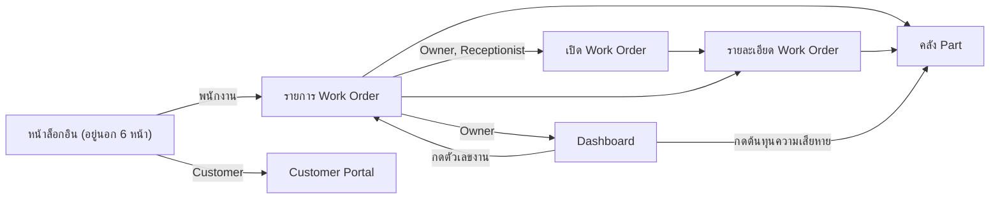

# Wireframe ของ RepairFlow

Wireframe แบบหยาบ 6 หน้า เพื่อตกลงลำดับการใช้งานก่อนเขียน UI ใน Sprint 2 ไม่ได้กำหนดหน้าตาจริง และเปิดดูบน GitHub ได้โดยไม่ต้องใช้เครื่องมือเฉพาะ

กฎอยู่ใน [PRD](../prd.md), [ตารางสิทธิ์](../architecture.md#authentication-และ-authorization) และ [GLOSSARY](../../GLOSSARY.md) ถ้าข้อความขัดกัน เอกสารเหล่านั้นใช้แทน

## หน้าทั้งหมด

| หน้า | Owner | Receptionist | Technician | Customer |
|---|---|---|---|---|
| [รายการ Work Order](work-order-list.md) | ทั้งร้าน | ทั้งร้าน | ทั้งร้าน | ไม่ใช้หน้านี้ |
| [เปิด Work Order](work-order-new.md) | ใช้ได้ | ใช้ได้ | ไม่ได้ | ไม่ได้ |
| [รายละเอียด Work Order](work-order-detail.md) | ทำได้ทุกส่วน | งานหน้าร้าน | เขียนได้เฉพาะงานที่รับมอบหมาย | ไม่ใช้หน้านี้ |
| [คลัง Part](inventory.md) | ทำได้ทุกส่วน | ดูยอด | ดูยอด | ไม่ได้ |
| [Customer Portal](customer-portal.md) | ไม่ใช้หน้านี้ | ไม่ใช้หน้านี้ | ไม่ใช้หน้านี้ | ของตนเท่านั้น |
| [Dashboard](dashboard.md) | ใช้ได้ | ไม่ได้ | ไม่ได้ | ไม่ได้ |

Platform Admin ไม่ใช้หน้าใดใน 6 หน้านี้ เพราะอ่านข้อมูลงานซ่อมไม่ได้ ([ADR-0009](../adr/0009-platform-admin-cannot-read-shop-data.md))

## วิธีอ่าน

ข้อความในกรอบเป็นภาษาอังกฤษเท่าที่ทำได้ เพื่อให้คอลัมน์ไม่เคลื่อน ส่วนข้อมูลในตัวอย่าง เช่น `WO-1042` เป็นค่าสมมติ

| สัญลักษณ์ | ความหมาย |
|---|---|
| `{O}` | Owner |
| `{R}` | Receptionist |
| `{T}` | Technician ที่รับมอบหมายงานนี้ |
| ไม่มีป้ายในวงเล็บปีกกา | ทุกบทบาทที่เข้าหน้านี้ได้เห็น |
| `*` | ช่องที่ต้องกรอก |
| `[ยังไม่ตัดสิน Qn]` | ขึ้นกับ[คำถามเปิดใน PRD](../prd.md#คำถามที่-acceptance-criteria-ยังตอบไม่ได้) wireframe ไม่ได้เลือกคำตอบ |
| `[ไม่ระบุ]` | เอกสารต้นทางยังไม่ได้กำหนด และไม่ได้อยู่ในคำถามเปิดของ PRD ดู[รายการด้านล่าง](#สิ่งที่พบระหว่างทำ-wireframe) |

ปุ่มที่ไม่มีสิทธิ์จะไม่แสดง แต่การซ่อนปุ่มไม่ใช่การกันสิทธิ์ เพราะ backend ต้องปฏิเสธเองเมื่อเรียก API โดยตรง (AC-03)

## ส่วนที่ใช้ร่วมกัน

```text
พนักงาน
+-- RepairFlow | Work Orders | Parts | Dashboard{O} | [Notifications 3] | Somsri v
|
|  (แถบสถานะร้าน แสดงเมื่อเป็น Expired Shop)
|
|  ...เนื้อหาของหน้า...

Suspended Shop
+-- RepairFlow
|
|  ร้านถูกระงับ ใช้งานไม่ได้
```

แถบบนของ Customer มีเฉพาะ `[Notifications]` และเมนูบัญชี ส่วน Notification ดึงตอนเปิดหน้าหรือกลับมาที่แท็บ ไม่มี realtime

ผลของ[สถานะร้าน](../architecture.md#การเงิน)กับทุกหน้า (AC-05):

| สถานะร้าน | พนักงาน | Customer |
|---|---|---|
| Trial หรือ Subscription ใช้งานอยู่ | ปกติ | ปกติ |
| Expired Shop | อ่านอย่างเดียว ซ่อนปุ่มเขียนทุกปุ่ม และ[เปิด Work Order](work-order-new.md) ไม่ได้ | ติดตามงานและตอบ Quotation ที่ค้างได้ |
| Suspended Shop | เห็นเฉพาะหน้าแจ้งว่าร้านถูกระงับ | เห็นเฉพาะหน้าแจ้งว่าร้านถูกระงับ |

## ลำดับการใช้งาน



Workflow จาก RECEIVED ถึง DELIVERED ตาม AC-36:

| ขั้น | ผู้ทำ | หน้า | ผลต่อ Work Order |
|---|---|---|---|
| 1. เปิดงาน | Receptionist | เปิด Work Order | เริ่มที่ RECEIVED |
| 2. มอบหมาย Technician | Receptionist | รายละเอียด | สถานะไม่เปลี่ยน |
| 3. เริ่มตรวจ | Technician ที่รับมอบหมาย | รายการ แล้วไปรายละเอียด | RECEIVED → DIAGNOSING |
| 4. ส่ง Quotation | Receptionist | รายละเอียด | DIAGNOSING → WAITING_FOR_APPROVAL |
| 5. ตอบ Quotation | Customer | Customer Portal | IN_PROGRESS หรือ WAITING_FOR_PARTS เมื่อรับ และ DIAGNOSING เมื่อปฏิเสธ |
| 6. Issue Part และซ่อม | Technician ที่รับมอบหมาย | รายละเอียด | ซ่อมเสร็จเป็น COMPLETED |
| 7. รับ Payment | Receptionist | รายละเอียด | สถานะไม่เปลี่ยน |
| 8. คืน Device | Receptionist | รายละเอียด | COMPLETED → DELIVERED เมื่อไม่มี Outstanding Balance |

## Acceptance Criteria กับหน้าที่รองรับ

ครบทุกข้อใน[Acceptance Criteria ของ Workflow หลัก](../prd.md#acceptance-criteria-ของ-workflow-หลัก)

- **ใช้งาน:** ผู้ใช้ทำหรือเห็นสิ่งที่ AC กำหนดได้บนหน้านั้น
- **สะท้อนผล:** กฎจริงอยู่ใน backend หน้าทำได้แค่แสดงผลลัพธ์ จึงต้องตรวจรับด้วยเทสต์ระดับ API ตาม[Test Plan](../prd.md#test-plan) ไม่ใช่ด้วยการดูหน้า

| AC | หน้าที่รองรับ | สิ่งที่หน้าทำ | ระดับ | คำถามเปิด |
|---|---|---|---|---|
| AC-01 | [รายละเอียด](work-order-detail.md) | แสดงเฉพาะการเปลี่ยนสถานะที่ทำได้ และแสดง error โดยสถานะเดิมไม่เปลี่ยน | สะท้อนผล | |
| AC-02 | [รายละเอียด](work-order-detail.md) | Status History แสดงทุกการเปลี่ยนสถานะ ส่วน Audit Log ค้นได้ในหน้าที่อยู่นอก 6 หน้า | สะท้อนผล | |
| AC-03 | [รายการ](work-order-list.md), [เปิดงาน](work-order-new.md), [รายละเอียด](work-order-detail.md), [คลัง](inventory.md), [Portal](customer-portal.md), [Dashboard](dashboard.md) | ซ่อนปุ่มตามบทบาท และแสดงหน้าไม่มีสิทธิ์ | สะท้อนผล | |
| AC-04 | [รายการ](work-order-list.md), [รายละเอียด](work-order-detail.md), [Portal](customer-portal.md) | แสดงเฉพาะงานที่เห็นได้ และ URL ของงานอื่นแสดงไม่พบข้อมูล | สะท้อนผล | |
| AC-05 | [รายการ](work-order-list.md), [เปิดงาน](work-order-new.md), [รายละเอียด](work-order-detail.md), [คลัง](inventory.md), [Portal](customer-portal.md), [Dashboard](dashboard.md) | แถบสถานะร้าน อ่านอย่างเดียว และหน้าร้านถูกระงับ | ใช้งาน | |
| AC-06 | [รายละเอียด](work-order-detail.md), [Portal](customer-portal.md) | กดซ้ำได้ผลเดิม ไม่เกิดรายการซ้ำ | สะท้อนผล | |
| AC-07 | [เปิดงาน](work-order-new.md) | ฟอร์ม Customer, Device, อาการเสีย และ Promised Date | ใช้งาน | |
| AC-08 | [เปิดงาน](work-order-new.md), [รายละเอียด](work-order-detail.md) | แนบรูปไม่เกิน 5 รูป และอัปโหลดล้มเหลวแล้วทำงานต่อได้ | ใช้งาน | |
| AC-09 | [รายละเอียด](work-order-detail.md), [รายการ](work-order-list.md), [Portal](customer-portal.md) | มอบหมายในรายละเอียด และทุกหน้าที่เห็นงานแสดงผู้รับผิดชอบ | ใช้งาน | |
| AC-10 | [รายละเอียด](work-order-detail.md) | ปุ่มเริ่มตรวจแสดงตามบทบาท และ DIAGNOSING ไปต่อได้สองทาง | ใช้งาน | |
| AC-11 | [รายละเอียด](work-order-detail.md) | ฟอร์ม Quotation และปุ่มส่งของ Owner และ Receptionist | ใช้งาน | |
| AC-12 | [รายละเอียด](work-order-detail.md), [Portal](customer-portal.md) | ฉบับที่ส่งแล้วไม่มีปุ่มแก้ มีปุ่มออกฉบับใหม่ และ Superseded Quotation ตอบไม่ได้ | ใช้งาน | |
| AC-13 | [Portal](customer-portal.md), [รายละเอียด](work-order-detail.md) | Customer ตอบเองใน Portal และพนักงานบันทึกแทนพร้อมช่องทาง | ใช้งาน | |
| AC-14 | [Portal](customer-portal.md), [รายละเอียด](work-order-detail.md) | แสดง error และข้อมูลเดิมเมื่อ Approval ล้มเหลว | สะท้อนผล | |
| AC-15 | [Portal](customer-portal.md), [รายละเอียด](work-order-detail.md) | สถานะเป็น IN_PROGRESS และแสดงยอด Reserved | ใช้งาน | |
| AC-16 | [รายละเอียด](work-order-detail.md), [คลัง](inventory.md), [Portal](customer-portal.md) | สถานะเป็น WAITING_FOR_PARTS และแสดง Part Request | ใช้งาน | Q7 |
| AC-17 | [Portal](customer-portal.md), [รายละเอียด](work-order-detail.md) | ไม่มีปุ่มตอบเมื่อหมดอายุ และแสดง error เมื่อตอบซ้ำ | ใช้งาน | |
| AC-18 | [Portal](customer-portal.md), [รายละเอียด](work-order-detail.md) | ปุ่มปฏิเสธ และประวัติการตัดสินใจ | ใช้งาน | Q5 |
| AC-19 | [คลัง](inventory.md), [รายละเอียด](work-order-detail.md) | `RECEIPT` และการจัดลำดับคิวของ Owner และแสดงผลการจัดสรรในงาน | ใช้งาน | |
| AC-20 | [รายละเอียด](work-order-detail.md), [คลัง](inventory.md) | ทั้งปุ่มและการเปลี่ยนเองขึ้นกับคำตอบ | ใช้งาน | Q4 |
| AC-21 | [รายละเอียด](work-order-detail.md) | Issue ได้เฉพาะแถวที่มียอด Reserved ของงานนี้ | ใช้งาน | |
| AC-22 | [รายละเอียด](work-order-detail.md), [คลัง](inventory.md) | Issue หลายรายการด้วยปุ่มเดียว และดู Stock Movement ได้ | ใช้งาน | |
| AC-23 | [รายละเอียด](work-order-detail.md) | ปุ่ม `RETURN_UNUSED` | ใช้งาน | |
| AC-24 | [รายละเอียด](work-order-detail.md) | บันทึก Repair Damage พร้อมเหตุผล และขอชิ้นทดแทน | ใช้งาน | |
| AC-25 | [รายละเอียด](work-order-detail.md), [คลัง](inventory.md) | บันทึก DOA ในงาน และส่งเคลมด้วย `VENDOR_SEND` | ใช้งาน | |
| AC-26 | [รายละเอียด](work-order-detail.md), [Portal](customer-portal.md) | ส่ง Quotation เพิ่มเติมระหว่าง IN_PROGRESS และ Customer ตอบ | ใช้งาน | Q5 |
| AC-27 | [รายละเอียด](work-order-detail.md), [Portal](customer-portal.md) | ปุ่ม COMPLETED และการแจ้ง Customer ตามชนิดบัญชี | ใช้งาน | Q6, Q9 |
| AC-28 | [รายละเอียด](work-order-detail.md), [รายการ](work-order-list.md) | ฟอร์มบันทึกช่องทางและผู้ติดต่อ และตัวกรองงานที่มี Customer Contact Task ค้าง | ใช้งาน | |
| AC-29 | [รายละเอียด](work-order-detail.md) | ฟอร์ม Payment ยอด วิธีชำระ และผู้รับเงิน | ใช้งาน | |
| AC-30 | [รายละเอียด](work-order-detail.md) | แสดง Outstanding Balance | ใช้งาน | Q1, Q5 |
| AC-31 | [รายละเอียด](work-order-detail.md) | ปุ่ม DELIVERED แสดงเมื่อไม่มียอดค้าง และไม่แสดงให้ Technician | ใช้งาน | |
| AC-32 | [รายละเอียด](work-order-detail.md), [Portal](customer-portal.md) | ไม่มีปุ่มหลัง DELIVERED และ Customer เห็น Status History ครบ | ใช้งาน | |
| AC-33 | [รายละเอียด](work-order-detail.md) | ปุ่มยกเลิกพร้อมเหตุผล ไม่แสดงให้ Technician และไม่แสดงหลัง COMPLETED | ใช้งาน | |
| AC-34 | [รายละเอียด](work-order-detail.md), [คลัง](inventory.md) | ยอด Reserved ของงานกลับเป็น Available | ใช้งาน | Q9 |
| AC-35 | [รายละเอียด](work-order-detail.md) | ปุ่มคืน Device จาก CANCELLED | ใช้งาน | Q1 |
| AC-36 | [รายการ](work-order-list.md), [เปิดงาน](work-order-new.md), [รายละเอียด](work-order-detail.md), [Portal](customer-portal.md) | เดินครบตาม[ลำดับการใช้งาน](#ลำดับการใช้งาน) | ใช้งาน | |

Dashboard รองรับเฉพาะกฎร่วม AC-03 และ AC-05 เพราะ Acceptance Criteria ของ Workflow หลักไม่มีข้อเรื่องรายงาน หน้านี้มีไว้สำหรับปัญหาข้อ 6 และ User Story 13-14 ซึ่งตรวจรับด้วย[สถานการณ์ในตารางปัญหา](../prd.md#ปัญหาและสถานการณ์ที่พิสูจน์ได้)

## คำถามเปิดที่แต่ละหน้าทำเครื่องหมายไว้

| คำถาม | AC | หน้าที่ทำเครื่องหมาย |
|---|---|---|
| Q1 | AC-30, AC-35 | รายละเอียด |
| Q4 | AC-20 | รายละเอียด, คลัง |
| Q5 | AC-18, AC-26, AC-30 | รายละเอียด, Portal |
| Q6 | AC-27 | รายละเอียด, Portal |
| Q7 | AC-16 | รายละเอียด, คลัง, Portal |
| Q9 | AC-27, AC-34 | รายละเอียด, คลัง, Portal |

เมื่อคำถามใดมีคำตอบ ให้แก้เครื่องหมายในหน้าที่ระบุ และลบแถวออกจากตารางนี้

## สิ่งที่พบระหว่างทำ wireframe

เรื่องเหล่านี้เอกสารต้นทางยังไม่ได้กำหนด และไม่ได้อยู่ในคำถามเปิดของ PRD เจ้าของโปรเจกต์ควรตัดสินก่อนเริ่มหน้านั้น ถ้า wireframe ต้องวาดแบบใดแบบหนึ่ง หน้านั้นจะบอกไว้ว่าวาดอย่างไร

| เรื่อง | ปัญหา | กระทบ | หน้า |
|---|---|---|---|
| สิทธิ์ของ Customer Contact Task | ตารางสิทธิ์ไม่มีแถวนี้ มีเพียง User Story 22 ที่เขียนว่าพนักงาน จึงไม่รู้ว่ารวม Technician หรือไม่ | AC-28 | รายละเอียด |
| สิทธิ์แนบรูปหลังเปิดงาน | ตารางสิทธิ์ไม่มีแถวนี้ และ User Story 2 พูดถึงเฉพาะ Receptionist | AC-08 | รายละเอียด |
| ผู้สั่ง `RESERVE` ของชิ้นทดแทน | AC-24 ให้ใช้ `RESERVE` ตามปกติ แต่ตาราง Movement ระบุ `RESERVE` เฉพาะตอนเกิด Approval | AC-24 | รายละเอียด |
| ช่วงที่บันทึก Payment ได้ | AC-29 อยู่ใต้ COMPLETED แต่ตารางสิทธิ์ไม่จำกัดสถานะ จึงไม่รู้ว่าจ่ายก่อนซ่อมเสร็จได้หรือไม่ | AC-29 | รายละเอียด |
| ลิงก์เชิญ Customer ของ Owner | เอกสารระบุเฉพาะ Receptionist แม้ Owner จะมีสิทธิ์งานหน้าร้านอื่นทั้งหมด | AC-13 | รายละเอียด |
| คิวและประวัติของบทบาทอื่น | ตารางสิทธิ์ให้ Receptionist และ Technician "ดูยอด Part" แต่ไม่ได้ระบุว่ารวมคิว Part Request และ Stock Movement หรือไม่ | AC-19, AC-22 | คลัง |
| Promised Date บังคับหรือไม่ | AC-07 บอกว่าเก็บ แต่ไม่ได้บอกว่าต้องกรอก ขณะที่งานเกินกำหนดคำนวณจากค่านี้ | AC-07 | เปิดงาน |
| การส่งต่อหลังตรวจเสร็จ | Technician ส่ง Quotation ไม่ได้ แต่ไม่มีกลไกบอก Receptionist ว่าตรวจเสร็จแล้ว และไม่ได้ระบุว่าใครกรอกรายการ Part ใน Quotation | AC-10, AC-11 | รายละเอียด |
| ข้อมูลเงินใน Customer Portal | ขอบเขต MVP ระบุเฉพาะงาน สถานะ และ Quotation จึงไม่ได้แสดง Outstanding Balance และ Payment แต่ไม่มีข้อห้ามชัดเจน | AC-30 | Portal |
| รูปภาพใน Customer Portal | AC-08 ให้เปิดผ่าน API ที่ตรวจสิทธิ์ แต่ไม่ได้ระบุว่า Customer เห็นรูปของงานตนเองหรือไม่ | AC-08 | Portal |

นอกจากนี้ AC-13 และ AC-36 ต้องใช้หน้าล็อกอินและหน้ารับลิงก์เชิญ ซึ่งไม่อยู่ใน 6 หน้าตามขอบเขตของ [Sprint 1](../../.scratch/sprint-01-foundation/spec.md) และการค้น Audit Log ก็อยู่นอก 6 หน้าเช่นกัน
